# Plotline

Real estate platform MVP for plotted developments: buyers pick a plot on a live 3D site, hold it for 15 minutes and pay the token online; the developer runs sales, CRM, construction, contractors, materials, vendors and site attendance from one console, on the same live data.

> "Plotline" is a working name. Change it in `src/components/logo.tsx`, `src/app/layout.tsx` and the header/footer copy.

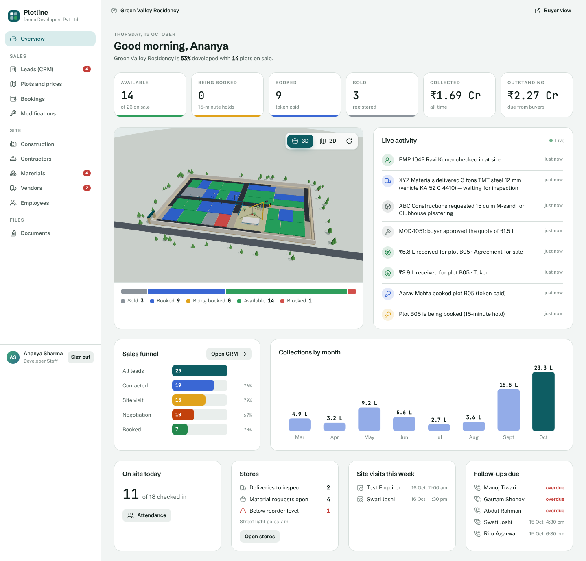

## What's in it

| Who | Where | What they can do |
| --- | --- | --- |
| Buyer | `/`, `/projects/…`, `/plots/…`, `/me` | Explore projects; filter plots in a **3D or 2D** site map; see price history and premiums; compare up to 3 plots; book a site visit (lands in the CRM); hold a plot for 15 min, upload ID, pay the token; pay later installments; download their documents; request changes and approve quotes; get notifications |
| Developer staff | `/console` | Live overview (KPIs, sales funnel, collections, 3D site, activity feed); **CRM** pipeline with drag-and-drop, lead timeline, calls/WhatsApp log, site visits, follow-ups; plots and prices (inline edit, % revision, CSV import, block/release); bookings and collections; buyer modification quotes; **construction updates by milestone with 3D replay**; contractors with work packages and **material issued vs used vs wasted**; materials ledger with a **3D store yard**; vendor deliveries and inspection; employees and geofenced attendance; documents |
| Contractor | `/portal` | Update progress on their work packages, request material, record usage and wastage, see their crew |
| Vendor | `/portal` | Log deliveries (vehicle, invoice, photo), see inspection results |
| Site employee | `/portal` | Selfie + GPS check-in checked against the site geofence, check-out, attendance history |

### The 3D site
`src/components/three/site-scene.tsx` (React Three Fiber). Every element is driven by milestone progress (0–100): the compound wall rises, asphalt spreads along the roads with a road roller working the front, drains extend, street lights pop up pole by pole, the overhead tank and clubhouse rise (with a tower crane while it's being built), and the park greens up with trees. Each construction update stores a snapshot, so the project page can **replay the whole build** with the Replay button. Plots are extruded from their outline and coloured by live status; held plots pulse. It pauses when off screen, falls back to the 2D map without WebGL, and fits any screen size.

## Screens

| | |
| --- | --- |
| 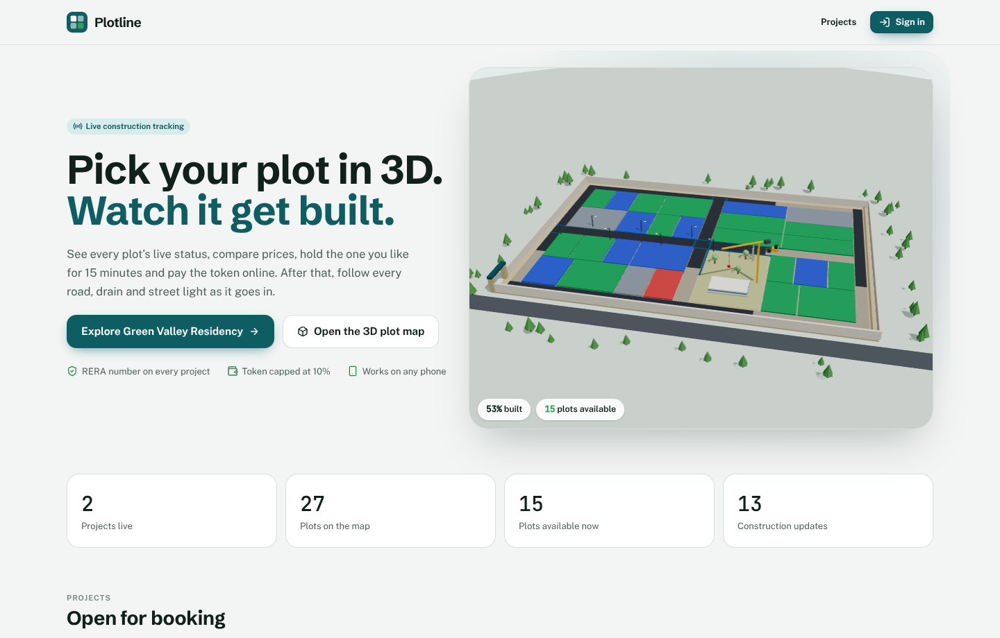 Landing page with the live 3D site | 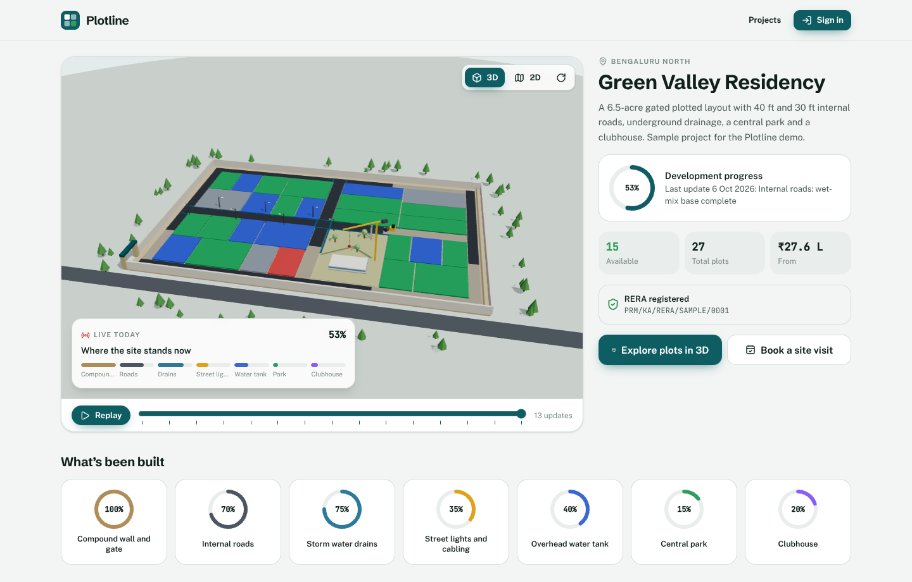 Project page: construction replay and milestone progress |
| 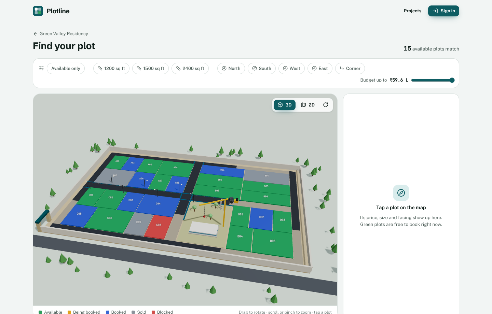 Plot explorer (3D/2D, filters, live status) | 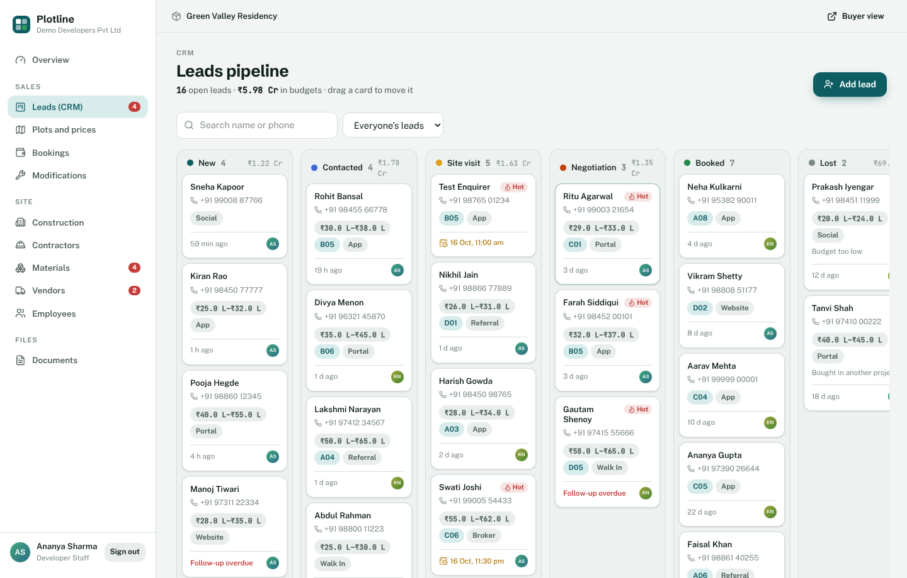 CRM pipeline with drag-and-drop |
| 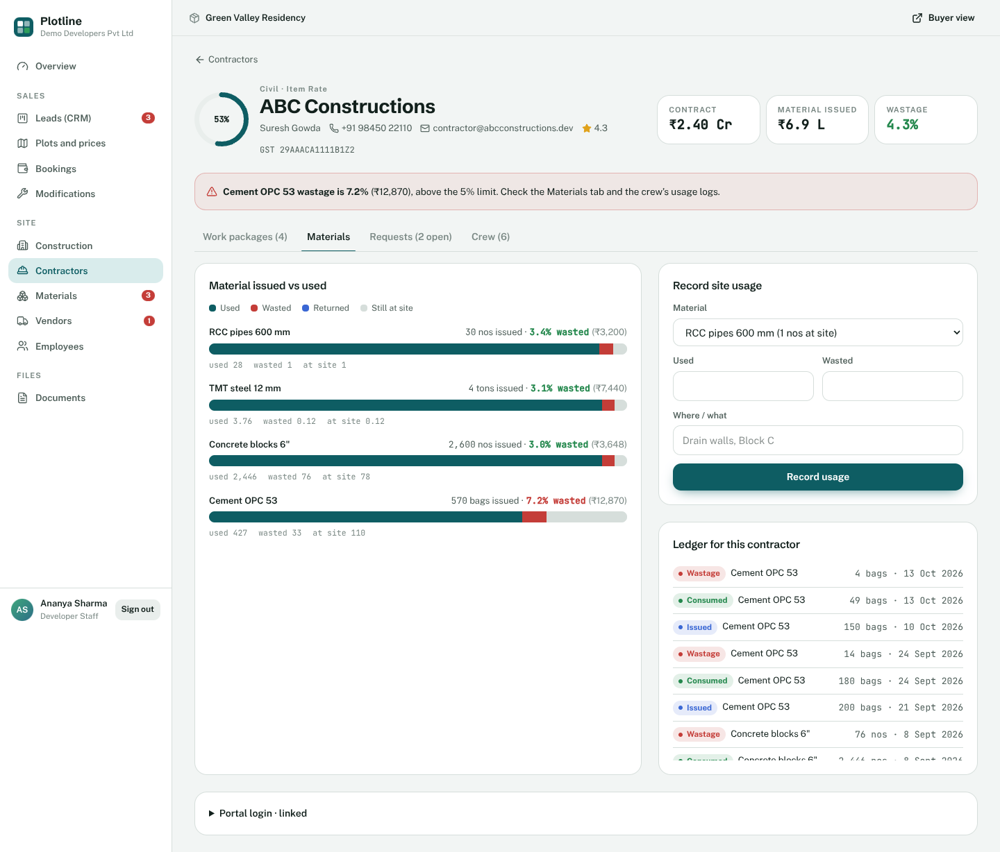 Contractor: material issued vs used vs wasted | 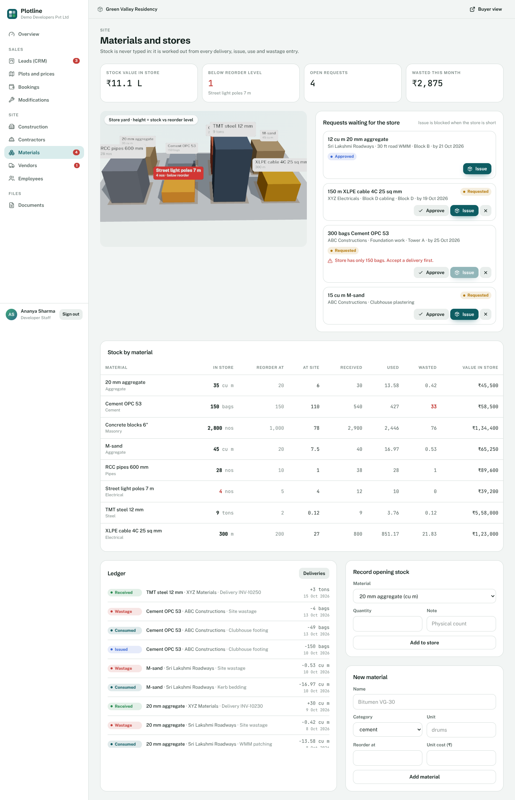 Materials ledger with the 3D store yard |
| 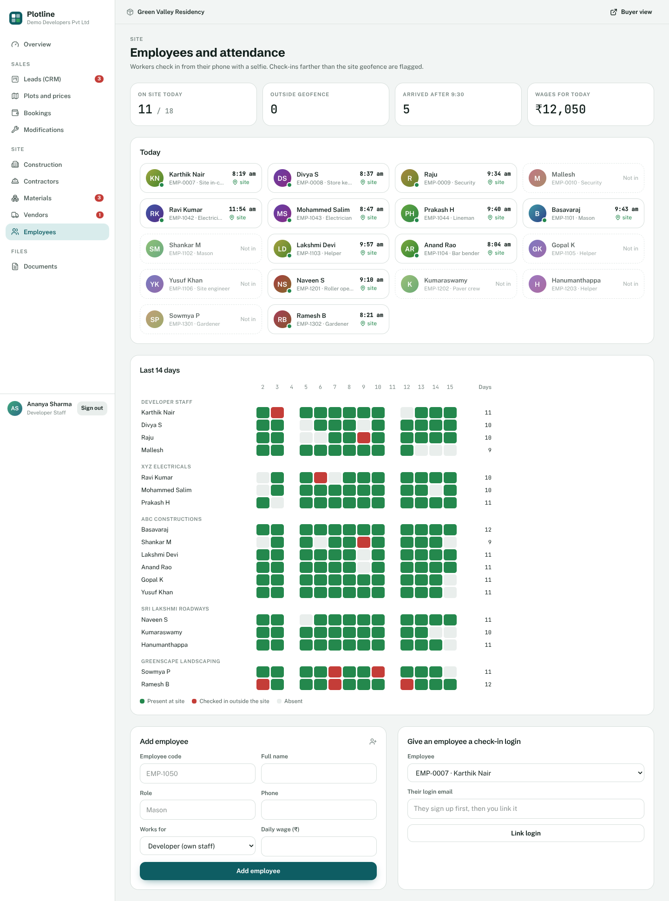 Employees: today's board and 14-day attendance | 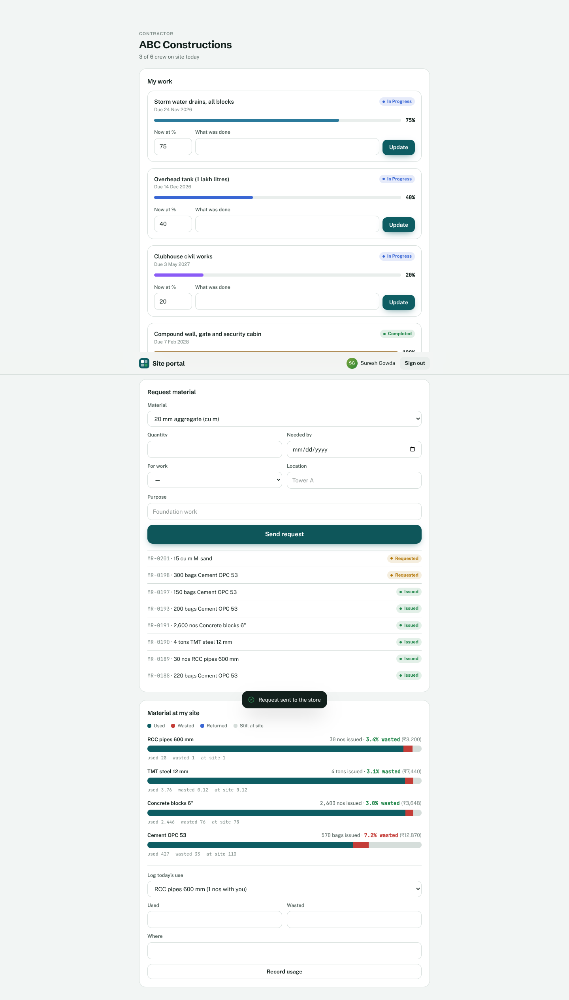 Contractor portal |
| 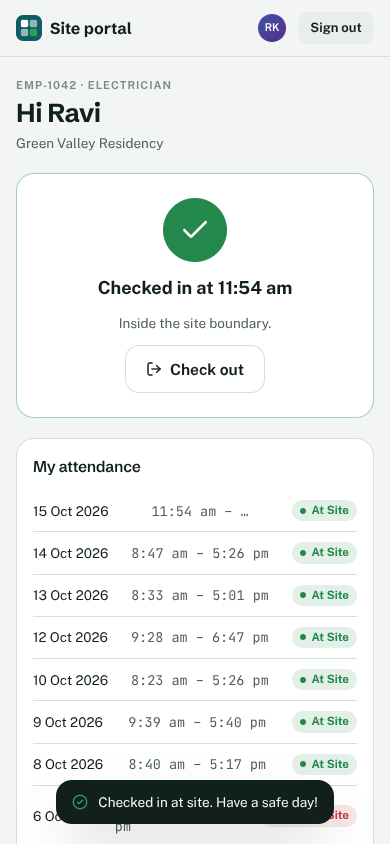 Employee GPS + selfie check-in | 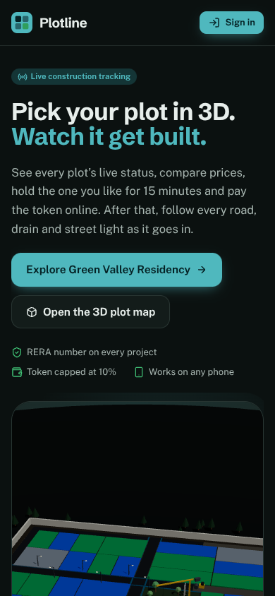 Phone, dark mode |

## Stack

- **Next.js 15** (App Router, server components, server actions) + TypeScript + Tailwind CSS 4
- **Supabase**: Postgres with row-level security on every table, Auth (email + phone OTP), Storage, Realtime
- **React Three Fiber / three.js** for 3D, **framer-motion** for UI motion, **dnd-kit** for the CRM board
- **Razorpay** Orders API + Checkout + webhooks (or a built-in simulator for demos)

All business rules live in the database (`supabase/migrations`), so the web app, a future mobile app and any integration get the same guarantees: no double booking, token capped at 10%, stock that can't go negative, contractors who can only see their own records.

## Run it locally (about 15 minutes)

### 1. Create a Supabase project
[supabase.com](https://supabase.com) → New project (region: **Mumbai**). Then, in **Project Settings → API**, copy the Project URL, the `anon`/publishable key and the `service_role`/secret key.

### 2. Configure and install
```bash
git clone https://github.com/MrRouhin/real_estate_startup.git && cd real_estate_startup
cp .env.example .env.local     # paste the three Supabase values
npm install
```

### 3. Create the database
```bash
npx supabase login
npx supabase link --project-ref <your-project-ref>
npx supabase db push            # runs the 9 migrations in supabase/migrations
```
Then in the Supabase dashboard:
- **Database → Extensions → pg_cron**: enable it, then run in the SQL editor:
  ```sql
  select cron.schedule('release-expired-holds', '* * * * *', 'select public.release_expired_holds()');
  ```
- **Authentication → Providers → Phone**: enable, and for testing add test numbers with fixed OTPs (for example `919999900001` → `123456`). Real SMS in India needs DLT registration; start that early.

### 4. Seed the demo and start
```bash
npm run seed       # creates logins, a project with 27 plots, bookings, CRM, contractors, stock…
npm run dev        # http://localhost:3000
```
Run `npm run seed -- --reset` any time to wipe the demo organization and start fresh.

### Demo logins (password `Plotline@2026`)

| Role | Email |
| --- | --- |
| Developer console | `sales@demodevelopers.dev` |
| Buyer | `buyer@plotline.dev` (or phone `+91 99999 00001` with your test OTP) |
| Contractor | `contractor@abcconstructions.dev` |
| Vendor | `vendor@xyzmaterials.dev` |
| Site employee | `employee@plotline.dev` |
| Platform admin | `admin@plotline.dev` |

The login page lists these. Set `NEXT_PUBLIC_SHOW_DEMO_LOGINS=false` to hide them.

## Payments

- `PAYMENTS_MODE=simulated` (default): a clearly labelled test checkout stands in for Razorpay, so the full booking flow works without a merchant account. **Never use this in production.**
- `PAYMENTS_MODE=razorpay`: add `RAZORPAY_KEY_ID` and `RAZORPAY_KEY_SECRET` (test keys first). In the Razorpay dashboard set payment capture to automatic and add a webhook to `https://<your-domain>/api/webhooks/razorpay` for `payment.captured` and `payment.failed`, with the secret in `RAZORPAY_WEBHOOK_SECRET`.

The amount always comes from the database. The webhook is the source of truth and is safe to receive twice. A payment that lands after the hold expired, when another buyer has taken the plot, becomes `refund_due` instead of double-selling it.

## Put it online (Vercel + Supabase, free tiers)

GitHub stores the code; it can't run it. GitHub Pages only serves static files, and this app needs a server (logins, payments, server actions) plus a database. So: **Supabase** runs the database, **Vercel** runs the website, and Vercel redeploys automatically every time you push to `main`.

1. **Database**: do steps 1 and 3 of "Run it locally" (create the Supabase project, `npx supabase db push`, pg_cron), then `npm run seed` once so the demo has data.
2. **Website**: [vercel.com/new](https://vercel.com/new) → sign in with GitHub → **Import** `real_estate_startup` → Framework: Next.js (auto-detected) → add these environment variables → **Deploy**:

   | Name | Value |
   | --- | --- |
   | `NEXT_PUBLIC_SUPABASE_URL` | Supabase → Project Settings → API → Project URL |
   | `NEXT_PUBLIC_SUPABASE_ANON_KEY` | the `anon` / publishable key |
   | `SUPABASE_SERVICE_ROLE_KEY` | the `service_role` / secret key (server only, never in client code) |
   | `PAYMENTS_MODE` | `simulated` for the demo, `razorpay` once you have keys |
   | `NEXT_PUBLIC_SITE_URL` | your Vercel URL, e.g. `https://real-estate-startup.vercel.app` |
   | `NEXT_PUBLIC_REALTIME` | `on` |

3. **Tell Supabase about the URL**: Supabase → Authentication → URL configuration → set Site URL to the Vercel URL.
4. Open the Vercel URL and sign in with any demo login above.

**No Node on your laptop?** On the GitHub repo page: **Code → Codespaces → Create codespace on main**. It opens VS Code in the browser with Node ready, so you can run `npm install`, `npx supabase db push`, `npm run seed` and even `npm run dev` there; Codespaces gives you a preview link for port 3000.

Before real buyers: switch payments to Razorpay, move Supabase to the **Pro** plan (free projects pause after a week of inactivity and have no daily backups), and add your own domain in Vercel → Settings → Domains.

## Working on the code
- `.env.local` is git-ignored, so keys stay on your machine. Put production keys only in Vercel's environment variables.
- Work on a branch and open a pull request: GitHub Actions (`.github/workflows/ci.yml`) type-checks, builds and runs the database tests on every PR, and Vercel posts a preview URL for each one.
- New database change = new file in `supabase/migrations/` (never edit an applied one), then `npx supabase db push`.

## Project structure
```text
src/
  app/
    (site)/            buyer pages: landing, projects, plot explorer, plot, compare, book, me
    console/           developer console (+ actions.ts: all console server actions)
    portal/            contractor / vendor / employee portal
    api/payments/      create-order, verify, simulate      api/webhooks/razorpay
  components/
    three/             site-scene (3D site), construction-timeline (replay), stock-yard (3D stores)
    ui/                motion (counters, tilt cards, rings), sheet, toast, tabs, forms
  lib/                 supabase clients, auth/roles, formatting, site geometry
supabase/
  migrations/          0001 core schema … 0009 realtime — the whole backend
  tests/               SQL tests for RLS, booking, stock, attendance, CRM
scripts/seed.mjs       demo data for any Supabase project
```

## Database at a glance

| Migration | Adds |
| --- | --- |
| 0001 core schema | organizations, profiles, projects, plots, price history, bookings, payment schedule, payments, documents, updates, announcements, notifications |
| 0002 security | row-level security for every table |
| 0003 booking functions | `hold_plot`, `start_booking`, `mark_payment_paid`, `release_expired_holds` |
| 0004 views | `project_stats`, `booking_balances` |
| 0005 content | push tokens, buyer notifications, storage rules (documents, media, KYC) |
| 0006 milestones | milestones + weighted project %, update snapshots for 3D replay, activity feed, payment plans, installment payments |
| 0007 operations | contractors, work packages, materials, vendors, deliveries, material requests, **stock ledger**, employees, attendance (geofence), modification requests |
| 0008 CRM | leads, lead activities, site visits, public enquiry function, auto-win on booking |
| 0009 realtime | publishes the live tables |

Run the SQL tests on any Postgres 15+:
```bash
createdb plotline_test
psql -d plotline_test -f supabase/tests/local_supabase_stub.sql
for f in supabase/migrations/*.sql; do psql -v ON_ERROR_STOP=1 -d plotline_test -f "$f"; done
for t in booking_flow_test content_test operations_crm_test; do psql -d plotline_test -f supabase/tests/$t.sql; done
```
Every check prints `t`.

## What's next
- **Mobile app**: wrap the buyer and portal flows in Expo. The API routes already accept `Authorization: Bearer` tokens.
- **Layout upload**: parse a developer's SVG layout into plot outlines (the `shape_path` column is ready).
- **Push notifications**: the `push_tokens` table and notification triggers are in place. Add a Supabase webhook on `notifications` that calls Expo Push.
- **AI**: document Q&A for buyers (pgvector), invoice OCR for vendor deliveries, wastage anomaly alerts per contractor.
